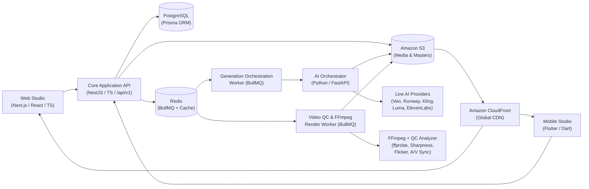
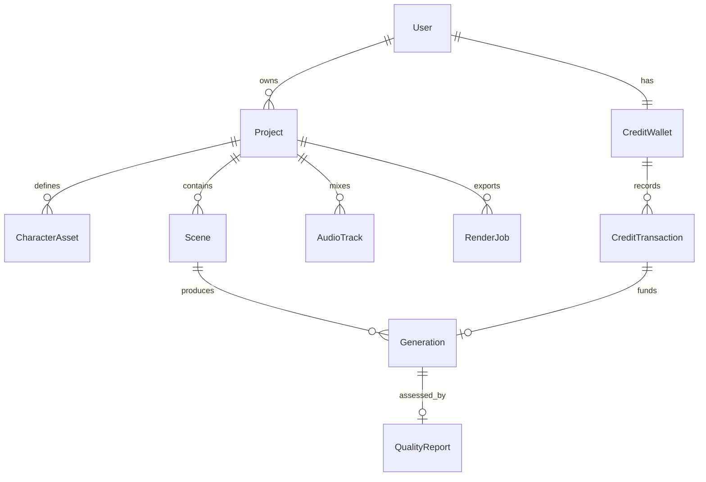

# CINEORA — System Architecture

## 1. High-Level Overview

CINEORA is a horizontally scalable, monorepo-based AI video production platform designed to deliver cinema-grade visual clarity, character/scene continuity, professional audio mixing, automated video quality control (QC), and quality-preserving FFmpeg rendering across dedicated Web and Mobile studios.



---

## 2. Monorepo Layout

Managed with **pnpm workspaces** and **Turborepo** for TypeScript packages, alongside dedicated Python (FastAPI) and Dart (Flutter) workspaces:

```text
CINEORA/
├── AGENTS.md                        # Always-on workspace engineering & quality rules
├── docs/
│   ├── ENGINEERING_RULES.md         # Canonical engineering & video quality specification
│   ├── ARCHITECTURE.md              # This document
│   └── RUNBOOK.md                   # Local dev, testing, and deployment runbook
├── apps/
│   ├── web/                         # Next.js (App Router), React, TypeScript
│   ├── mobile/                      # Flutter & Dart (Android & iOS)
│   └── api/                         # NestJS, TypeScript, Prisma, BullMQ producers
├── services/
│   ├── ai-orchestrator/             # Python, FastAPI, AI provider adapters & quality selector
│   └── media-worker/                # BullMQ worker: Automated Video QC + FFmpeg rendering
├── packages/
│   ├── contracts/                   # Shared versioned API contracts (Zod + OpenAPI -> TS/Dart/Python)
│   └── config/                      # Shared ESLint, Prettier, TypeScript configs
├── infra/
│   ├── docker/                      # Dockerfiles for api, web, ai-orchestrator, media-worker
│   └── aws/                         # AWS IaC blueprint (ECS/RDS/ElastiCache/S3/CloudFront)
├── docker-compose.yml               # Local stack: Postgres, Redis, MinIO (S3), services
├── .env.example                     # Root environment variable template
└── package.json                     # Monorepo scripts & workspace config
```

---

## 3. Core Services & Responsibilities

### 3.1 Core Application Backend (`apps/api` — NestJS + TypeScript + Prisma)
- **Versioned REST API (`/api/v1`)** with OpenAPI/Swagger generation and strict DTO/Zod validation.
- **Modular NestJS Domains:**
  - `auth` — JWT access + rotating refresh tokens, RBAC, password hashing (Argon2/bcrypt).
  - `users` — Profiles, preferences, studio workspace settings.
  - `credits` — Double-entry credit ledger (`RESERVE`, `SETTLE`, `REFUND`, `TOPUP`) with idempotency keys so credits are atomically reserved before generation and reconciled upon completion or failure.
  - `projects` — Video production projects (format preset: film, ad, news, documentary, social; aspect ratio; target resolution 1080p/4K; target FPS; colour profile).
  - `continuity` — Style Bible & Character Assets (reference images, wardrobe, lighting/LUT/camera language rules enforced across scenes).
  - `scenes` — Ordered scene breakdown (script/narration, visual prompt, shot type, camera movement, lighting, duration, active generation pointer, individual scene regeneration).
  - `generations` — Generation history, provider/model metadata, explicit `LIVE` vs `DEMO` mode flag, real-time status tracking, provider job IDs, error tracking, and QC report links.
  - `audio` — Narration, dialogue, voiceover, background music, and SFX tracks with gain/timing controls.
  - `renders` — Final project assembly & export jobs (`CINEMA_4K`, `BROADCAST_1080P`, `WEB_MASTER`, `SOCIAL_9_16`).
  - `storage` — Presigned S3 upload/download URLs and CloudFront signed delivery URLs.
  - `realtime` — Server-Sent Events (SSE) / WebSocket progress updates for generation, QC, and rendering.

### 3.2 AI Orchestrator (`services/ai-orchestrator` — Python + FastAPI)
Strictly separated from the core NestJS backend; communicates over internal authenticated HTTP + async callbacks/polling:
- **Provider-Agnostic Adapter Layer (`adapters/`):**
  - Abstract `VideoProviderAdapter` and `AudioProviderAdapter` base classes.
  - Genuine provider API integrations (never static sample video substitutes).
  - Initial adapter targets:
    - **Video:** Google Veo, Runway (Gen-4 / Gen-3), Kling AI, Luma Ray 2 (extensible to OpenAI Sora and others).
    - **Audio / Voice / Lip-Sync:** ElevenLabs, OpenAI TTS, and provider-native audio/lip-sync where supported.
- **Provider & Model Capability Registry (`registry.py`):**
  - Declares verified capabilities per model: max native resolution (1080p/4K), aspect ratios, max clip duration, FPS, character/image reference support, native audio/lip-sync, credit cost per second, speed tier, and **explicit limitations**.
- **Quality-First Provider Selector (`selector.py`):**
  - Ranks providers against requested production quality tier (`STANDARD`, `HIGH`, `CINEMA_MASTER`), realism, resolution, motion, audio/lip-sync, speed, and cost.
  - **Hard Rule:** Never automatically downgrades to a cheaper model if it would materially compromise requested visual/production quality; always discloses chosen model specs and limitations.
- **Cinematic Prompt & Shot Compiler (`prompt_compiler.py`):**
  - Translates structured scene parameters (shot type, camera movement, lens/depth of field, lighting, colour grading, character/wardrobe continuity bible, negative artifact guards) into provider-optimized generation payloads.
- **Strict Demo vs. Live Mode Separation:**
  - `LIVE` mode requires configured server-side provider credentials and invokes genuine external APIs. If credentials are missing or a provider is unreachable, it returns an honest, structured error.
  - `DEMO` mode is explicitly flagged in requests, database records, and UI responses as a non-live pipeline dry-run (never pretending to be live AI generation).

### 3.3 Video QC & FFmpeg Media Worker (`services/media-worker` — BullMQ + FFmpeg)
Consumes asynchronous jobs from Redis/BullMQ queues (`scene-qc`, `scene-enhance`, `project-render`):
- **Automated Video Quality Control (QC) Pipeline:**
  - Runs `ffprobe` and frame-level analysis on every generated scene:
    - Resolution, aspect ratio, frame rate, codec, colour space, and bitrate verification.
    - Sharpness / blur detection (Laplacian variance across sampled frames).
    - Temporal flicker & sudden luma/exposure jump detection.
    - Frozen/black frame detection.
    - Audio stream presence, loudness (EBU R128 LUFS), clipping, and A/V duration/sync offset checks.
  - Produces a structured `QualityReport` stored in PostgreSQL; flags scenes that fall below threshold so users can regenerate or enhance individual scenes.
- **Honest, Real Video Enhancement Pipeline:**
  - Only exposes enhancements genuinely implemented in the worker (e.g., FFmpeg `hqdn3d`/`nlmeans` denoising, `vidstab` two-pass stabilization, high-quality Lanczos upscaling, 3D LUT / colour grading, optional `minterpolate` frame interpolation). Never advertises unimplemented features.
- **Quality-Preserving FFmpeg Assembly & Mastering:**
  - Preserves highest available source resolution, frame rate, aspect ratio, and BT.709/BT.2020 colour metadata.
  - Avoids generational loss: uses high-bitrate / low-CRF mastering (`CRF 16–18` H.264/H.265 `yuv420p` / `yuv422p10le` or ProRes intermediate where appropriate).
  - Multi-track audio mixing (`amix` / `sidechaincompress` music ducking under narration/dialogue) + EBU R128 loudness normalization (`loudnorm` `-14 LUFS` web/social, `-23 LUFS` broadcast).
  - Uploads masters to S3 and publishes CloudFront URLs.

---

## 4. Core Data Model (PostgreSQL + Prisma)



Key guarantees:
- **Referential integrity & auditability:** Every generation retains its full prompt, provider, model, mode (`LIVE` | `DEMO`), status history, provider error details, and linked credit transaction.
- **Scene-level regeneration:** Each `Scene` has a `1:N` relationship with `Generation` and an `activeGenerationId` pointer, enabling non-destructive regeneration and A/B comparison of takes without touching other scenes.
- **Atomic credits:** `CreditWallet.balance` and `reservedBalance` are updated inside Serializable/transactional Prisma queries with unique idempotency keys.

---

## 5. API Versioning & Shared Contracts (`packages/contracts`)

- All public endpoints are prefixed with `/api/v1`.
- Request/response schemas and domain enums (`ShotType`, `CameraMovement`, `LightingPreset`, `QualityTier`, `GenerationMode`, `GenerationStatus`, `ExportPreset`) live in `packages/contracts` using Zod.
- OpenAPI 3.1 spec is generated from NestJS + `packages/contracts`, powering strongly typed clients for both **Next.js (`apps/web`)** and **Flutter (`apps/mobile`)**.

---

## 6. Security, Secrets & AWS Cloud Architecture

- **Zero frontend secrets:** All AI provider keys, payment credentials, S3 signing keys, and database credentials live strictly in server-side environment variables / AWS Secrets Manager.
- **Media security:** Private S3 buckets with CloudFront Origin Access Control (OAC) and time-limited signed URLs.
- **Horizontal scalability:** Stateless NestJS API, FastAPI AI Orchestrator, and BullMQ workers scale independently on AWS ECS Fargate / EKS behind an Application Load Balancer, backed by RDS PostgreSQL (Multi-AZ) and ElastiCache Redis.
